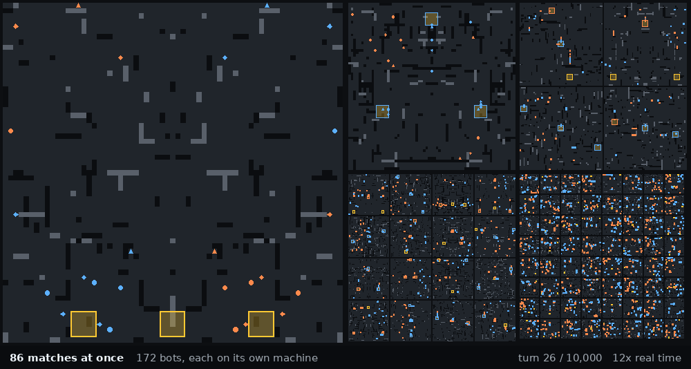
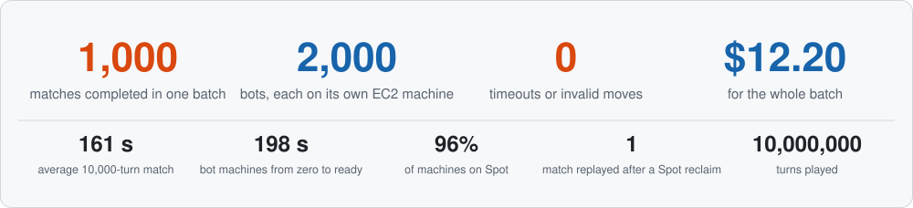

# AWS Distributed Simulation Platform

[](https://aws.amazon.com/ecs/)
[](https://developer.hashicorp.com/terraform)
[](https://www.rust-lang.org/)
[](https://www.python.org/)
[](https://aws.amazon.com/rds/postgresql/)
[](https://www.docker.com/)
[](https://github.com/features/actions)

Distributed execution of competitive bot matches on AWS. Each match runs in its own container, and each bot on its own EC2 instance, isolated from its opponent. A batch scales from zero to thousands of single-use Spot instances and back to zero. Matches that fail because of the infrastructure are voided and played again.

Built as the match backend for a bot programming competition.

<p align="center">
  
</p>
<p align="center"><sub>Replays of 86 matches played on AWS, 10,000 turns each. Every bot ran on a machine of its own.</sub></p>

<p align="center">
  <picture>
    <source media="(prefers-color-scheme: dark)" srcset="docs/assets/stats-dark.svg">
    
  </picture>
</p>

<p align="center">
  <picture>
    <source media="(prefers-color-scheme: dark)" srcset="docs/assets/architecture-dark.png">
    
  </picture>
</p>
<p align="center"><sub>Generated from <a href="docs/assets/architecture.py">docs/assets/architecture.py</a> with <a href="https://diagrams.mingrammer.com">diagrams</a>. Faded parts are planned.</sub></p>

---

## Contents

- [Overview](#overview)
- [Architecture](#architecture)
- [Results](#results)
- [Bot isolation](#bot-isolation)
- [Principles](#principles)
- [Workflow and CI/CD](#workflow-and-cicd)
- [Running it](#running-it)
- [Repository layout](#repository-layout)
- [Limitations and next steps](#limitations-and-next-steps)
- [Acknowledgments](#acknowledgments)

---

## Overview

A batch runner plans the batch from the account's quotas and starts single-use bot machines, Spot first and on-demand for what Spot cannot supply. It then starts one match task per match whenever two free machines are available. The match task runs the game controller on Fargate and starts the two bots on their machines, each with a single-use token. The bots' relays dial the controller over TCP, the controller times every answer and applies the moves through the game's rules, and the match task writes the result to PostgreSQL and the replay to S3. Each bot's machine terminates after its match.

Games plug in as controller images and bots as bot images. Without them, a batch plays the repository's toy games with a sample bot.

## Architecture

The batch runner controls both machine groups during a batch. It keeps 1% spare machines, so a bot meant for a machine AWS reclaims starts on a spare one. Each poll it sets each group to its busy machines plus what the batch still needs, and replaces a reclaimed machine as soon as its two-minute warning arrives. It also terminates machines that ended through their group, because a group notices a machine that shut itself down only minutes later.

Details: [docs/architecture.md](docs/architecture.md). The protocol between controller and bots: [docs/contracts.md](docs/contracts.md). The code, step by step: [docs/how-it-works.md](docs/how-it-works.md).

## Results

One batch of 1,000 matches on AWS, `eu-central-1`, 2026-11-15, with games of 10,000 turns:

| Measure | Result |
|---|---|
| Matches | 1,000 of 1,000 completed. One was voided when AWS reclaimed a bot's Spot machine mid-match, and played again with the same seed |
| Turns played | 10,000,000 |
| Timeouts, invalid moves | 0, 0 |
| Bots | Each on its own EC2 machine: 2,002 bots, counting the replayed match, on 2,002 of 2,137 machines launched, 96% of them Spot |
| Match of 10,000 turns | 161 s on average, including the bots' start |
| Bot machines from zero to ready | 198 s |
| Cost of the batch | About $12.20 |

An isolation probe, run from inside a bot's task, finds the other bot, the database, the internet, the ECS API and the instance metadata service unreachable.

## Bot isolation

Bots are written by competitors and are treated as untrusted code. A bot that shares a machine with its opponent can read the opponent's memory and environment through `/proc` and compete with it for CPU time. Each bot therefore runs on its own EC2 instance, in a private subnet without an internet route and without AWS credentials. Its security group allows outbound TCP 9000 to the match tasks and HTTPS to the VPC endpoints for image pulls and logs.

## Principles

- **Untrusted bot input.** The controller validates every message a bot sends. The relay that runs in the bot's container is not treated as a security boundary.
- **One EC2 instance per bot.** A bot shares no CPU, memory, storage or network interface with another bot or with the controller. The instance is terminated after its bot exits and never runs a second one.
- **Least privilege for bots.** Bot containers run without a task role, with a read-only root filesystem, no Linux capabilities and a hard time limit.
- **Controller-side timing.** The controller enforces each turn's deadline, timestamps messages on arrival, and writes to both bots concurrently, so a slow or unresponsive bot cannot delay the match or its opponent.
- **Infrastructure failures void the match.** If a bot never starts, or AWS reclaims its instance, the match is voided and played again with the same seed.
- **Deterministic replays.** A replay stores the seed and the moves. Running it through the game again must reproduce the scores.
- **No idle compute.** Between batches, only the database and the VPC interface endpoints run. Alarms report instances or tasks running longer than any batch, Spot quota use above 90%, database limits, voided matches and cost anomalies.
- **Reviewed infrastructure changes.** Terraform changes are planned on the pull request and applied from `main`. Images are immutable and tagged with their commit.

## Workflow and CI/CD

<p align="center">
  <picture>
    <source media="(prefers-color-scheme: dark)" srcset="docs/assets/workflow-dark.png">
    
  </picture>
</p>
<p align="center"><sub>Generated from <a href="docs/assets/workflow.py">docs/assets/workflow.py</a> with <a href="https://diagrams.mingrammer.com">diagrams</a>.</sub></p>

Match execution was split across three repositories: the game, the platform code (`platform-game`) and the infrastructure. This repository combines the platform code, in `platform/`, with the infrastructure, in `infra/` and `.github/`. The parts exchange only container images with immutable tags, and GitHub Actions reaches AWS only through OIDC roles, without stored keys.

**Game releases.** The game's repository checks every pull request with `cargo fmt`, `clippy` and its tests. A version tag `vX.Y.Z` on `main` starts its release workflow: the tag must match the crate's version and point to a commit on `main`, the tests run again, and the controller image is built and plays a smoke match against the platform's relay and sample bot. Only then is the image pushed to ECR under its version tag, and a GitHub release records the tag, the commit and the image digest. The push role trusts only that workflow, on `v*` tags of that repository, and may only push to that one ECR repository.

**Platform images.** Pull requests to the platform code run the Rust tests, also on the minimum supported Rust version, the Python tests, Ruff, strict mypy for the dispatcher, and contract tests between the dispatcher and the controller. `push-image.sh` builds the match image on top of a game's controller image, and the bot image, and tags both with the commit and the game version. Every result records the game version it was played with.

**Infrastructure.** Every pull request runs `terraform fmt`, `validate` and `tflint`, a Trivy scan of the infrastructure code, and actionlint, zizmor and shellcheck on the workflows and scripts. Each environment's plan is posted as a PR comment, with sensitive values redacted. In this repository, one required check, `ci-result`, combines the platform and infrastructure jobs.

- **Saved plans only.** A push to `main` plans each environment and stores the plan. In dev, a plan that destroys, replaces and forgets nothing is applied in the same run. Any other plan waits in an issue until an approver runs `apply.yml`. A plan is refused if `main` or the state has changed since it was made.
- **Roles.** The plan role is read-only, because it runs code from pull requests, and is denied secret values and data reads. The apply role trusts only `main` and the two apply workflows, and for manual applies only the listed approvers. It can't change the CI roles, the OIDC provider, the state bucket's configuration or the bootstrap's state.
- **Merge gate.** Before an apply, a pre-flight check confirms that every commit since the last apply came from a merged PR that someone other than its author approved, with a green `ci-result`. This is a second layer behind the branch ruleset.
- **Drift and direct pushes.** A weekday job compares AWS with the Terraform state and opens or closes a `Drift detected` issue, ignoring attributes that change by themselves. Another job opens an issue when `main` moves without a merged PR.
- **Supply chain.** Actions are pinned to full commit SHAs, and CLI tools are installed at pinned versions with verified SHA-256 checksums. Base images are pinned by digest.

Each environment's role ARNs, state bucket and Terraform inputs come from one repository variable, `INFRA_<ENV>`. Until it exists, only the checks run. Details: [docs/ci-cd.md](docs/ci-cd.md). Setup: [docs/setup.md](docs/setup.md).

## Running it

Locally, with Rust and Docker:

```bash
cd platform
cargo test --workspace                     # protocol, controller and relay tests
cargo run -p local-runner -- coin ok ok    # one match of a toy game, in three containers
```

On AWS, after setting up the infrastructure ([docs/setup.md](docs/setup.md)):

```bash
cd platform
prototype/push-image.sh                    # match and bot images; prints the tag
uv run --with boto3 prototype/run_batch.py start --batch demo --games 1000 --image-tag TAG --bots ec2
uv run --with boto3 prototype/run_batch.py probe --batch probe-1 --image-tag TAG --bots ec2
```

A real game plugs in with `push-image.sh --controller-image`, and its bots with `run_batch.py --bot-image`.

## Repository layout

| Path | Contents |
|---|---|
| [`platform/`](platform) | Rust: game controller, relay, protocol, toy games, local runner. Python: the match task, the batch runner, a dispatcher and a sample bot |
| [`infra/`](infra) | Terraform: the CI bootstrap, and the dev environment with the cluster, Spot and on-demand bot machines, network, database, monitoring and alerts |
| [`docs/`](docs) | Architecture, protocol, the code explained, setup, and the infrastructure pipeline |
| [`.github/`](.github) | The workflows and scripts described in [Workflow and CI/CD](#workflow-and-cicd) |

## Limitations and next steps

- So far only our own bots have run on it. Bots can still resolve DNS names through the VPC resolver, so running contestants' code requires the planned DNS Firewall.
- Turn limits are not calibrated for ranked play yet. Ranked matches would use one instance type and limits measured on it.
- The dispatcher, which takes match requests from the competition's backend, and the submission builds, which compile contestants' code, are designed but not built.

## Acknowledgments

This project began as part of a team preparing a bot programming competition, and it wouldn't exist without the people I worked with.

A big thank you to [Julius Wendland](https://github.com/einbocha), who created the game these matches play. Every replay in the GIF at the top is his game.

Thank you as well to [Angelina Zijun Wan](https://github.com/zijunwanwan) and [Joshua Gao](https://github.com/Yoshi353), who worked on the competition's backend infrastructure. It was a pleasure being on the team with you.
