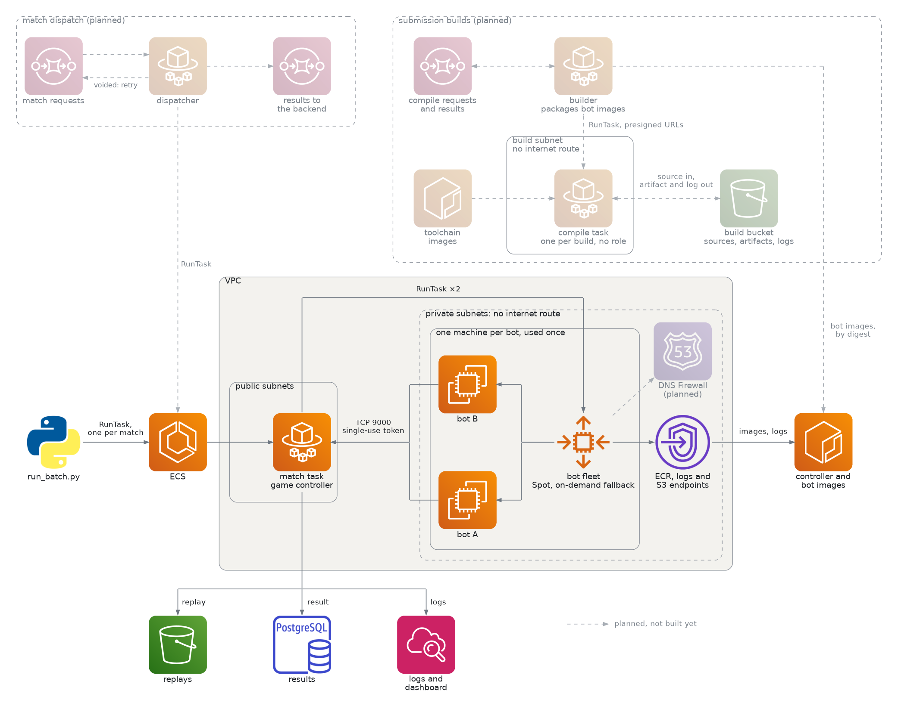

# Architecture

How a batch of matches runs on AWS, how bots are kept apart, and what the batch runner does with the machines. The protocol between the controller and the bots is in [contracts.md](contracts.md); the code, step by step, in [how-it-works.md](how-it-works.md); the infrastructure pipeline in [ci-cd.md](ci-cd.md).

## Components

| Component | Runs on | Role |
|---|---|---|
| Batch runner ([`run_batch.py`](../platform/prototype/run_batch.py)) | The operator's machine | Plans the batch, starts the bot machines and the match tasks, replays voided matches, stops idle machines, prints the report |
| Match task ([`match_task.py`](../platform/prototype/task/match_task.py)) | Fargate, 0.25 vCPU, one per match, in a public subnet | Runs the game controller, starts the two bot tasks, uploads the replay to S3, writes the result to Postgres |
| Game controller | Inside the match task | Accepts the two bots, checks their tokens, sends each turn, times the answers, applies the moves through the game's rules, writes `result.json` and the replay |
| Bot task | One EC2 machine of its own, in a private subnet | The bot and its relay; the relay dials the controller on TCP 9000 |
| Bot machines | Two Auto Scaling groups behind ECS capacity providers: Spot, and on-demand | One vCPU each, used for one bot and then terminated |
| Results | RDS for PostgreSQL (`db.t4g.micro`, 20 GiB) | One row per match attempt; the batch report is computed from it |
| Replays and logs | S3, CloudWatch Logs (365 days) | Replays hold the seed and the moves; match and bot logs |
| Images | ECR, reached through VPC endpoints | The match image (a game's controller plus the match task) and the bot images, tagged by commit |

Games plug in as controller images, bots as bot images. Without them, a batch plays the repository's toy games with its sample bot.

## A match

1. The match task generates a single-use token per bot and starts the controller with the match spec: seed, players and tokens, limits.
2. It starts both bot tasks with RunTask, passing each its token and the controller's private address, and drains each bot's machine as soon as the bot is placed, so ECS never places a second task there.
3. Each relay connects and authenticates. The controller sends the state of every turn to the players who move, enforces the deadline while it waits (2 s per turn plus 100 ms grace), and applies the answers. A bot that times out too often, sends invalid output or disconnects forfeits.
4. When the game ends or reaches its turn limit, the controller writes the result and the replay. The match task uploads the replay, writes the row and exits. Each bot's machine shuts itself down after its bot, and its launch template terminates it.

A match is voided, and never counted for or against a bot, when the infrastructure failed it:

| Status | Cause |
|---|---|
| `void_bot_never_connected` | A bot didn't connect within the 5-minute connect window, for example because its task never started |
| `void_bot_machine_lost` | A bot dropped out of the match, and ECS stopped its task without an exit code: its machine was reclaimed by AWS or failed |

The batch runner plays a voided match again with the same seed, up to three attempts in all.

## Bot isolation

Every bot is assumed hostile. What a bot runs with:

| Layer | Setting |
|---|---|
| Machine | A machine of its own, never shared with another bot or with the controller, and terminated after one bot. IMDSv2 only, and the ECS agent blocks the instance metadata service for tasks and refuses privileged containers |
| Container | No task role, so no AWS credentials. Read-only root filesystem, all Linux capabilities dropped, a hard deadline in the image |
| Network | Private subnets without a route to the internet. The security group allows outbound TCP 9000 to match tasks, and HTTPS to the VPC endpoints for the image pull and the logs. No inbound traffic |
| Credentials | A token that works once, for one slot of one match. Tokens travel in RunTask's overrides, so anyone who may call DescribeTasks in the account can read them; each is spent within seconds |

An isolation probe, `run_batch.py probe`, runs from inside a real bot task and tries to reach the other bot, the database, the internet by address and by name, the ECS API and the instance metadata service. All are unreachable except name resolution: the VPC's resolver still answers DNS queries, which a DNS Firewall is planned to restrict.

## Bot machines

| Group | Instance types | Zones | Maximum |
|---|---|---|---|
| Spot | `c8a.medium`, `m8a.medium`, `r8a.medium`: the same one-vCPU AMD EPYC 9005 at 4.5 GHz, with 2, 4 or 8 GiB, so every bot gets the same speed | eu-central-1a, b and c | The account's Spot quota |
| On-demand | `c8a.medium` | eu-central-1a, b and c | The account's on-demand quota |

ECS doesn't fall back from Spot to on-demand by itself. The batch runner does, and it controls both groups' desired capacity during a batch:

- Planning: it reads the Fargate, Spot and on-demand quotas and each group's maximum, and computes how many matches can run at once.
- Warm-up: it asks the Spot group for the first wave's machines plus 1% spares (at least 4), and waits until they're ready, or until no new machine has come for three minutes.
- Fallback: from two minutes on, on-demand machines make up for Spot machines that don't come.
- Waves: a match starts whenever two free machines of a group are there, so a batch larger than the quotas allow at once, or than Spot can supply, still completes.
- Balance: each poll sets each group to its busy machines, plus machines AWS is reclaiming, plus what the batch still needs. A bot meant for a reclaimed machine takes a spare one, and a reclaimed machine is replaced when its two-minute warning arrives.
- Hand-over: a machine shuts itself down after its bot, and its group notices only minutes later. The batch runner terminates ended machines through their group, without lowering it, so the group's count stays right.
- End: it terminates idle machines and sets both groups to zero.

## Network

| Subnet | CIDR | Route |
|---|---|---|
| Match tasks | `10.0.4.0/22` (a), `10.0.12.0/22` (b): about 2,000 addresses, one per running match | Internet gateway |
| Bots | `10.0.16.0/20` (a), `10.0.32.0/20` (b), `10.0.48.0/20` (c): about 4,000 addresses each, two per bot | None, plus the S3 gateway endpoint for image layers |
| Database | `10.0.8.0/24` (a), `10.0.9.0/24` (b) | None |

Interface endpoints for ECR, CloudWatch Logs and the ECS agent sit in zone a only; machines in zones b and c reach them across zones. Each further zone would cost another $0.012 per endpoint-hour around the clock.

## Monitoring and alerts

A CloudWatch dashboard shows matches playing per minute, results per batch, tasks that stopped abnormally with the reason, warnings and errors, the slowest matches, the database's load, and the alarms. Alarms email a list of recipients when they fire and when they clear:

| Alarm | Fires when |
|---|---|
| Machines left running | EC2 instances have run for all of the last 90 minutes |
| Tasks left running | Fargate tasks have run for all of the last 2 hours |
| Spot quota | Spot vCPUs in use pass 90% of the quota |
| Database | More than 70 connections, or less than 2 GiB free |
| Voided matches | More than 5% of the matches saved in 15 minutes were voided |
| Cost anomalies | AWS anomaly detection finds an unusual cost of $10 or more |

Two budgets alert on spend: one at 50, 80 and 100% of a monthly limit, counted before credits, and one as soon as $1 is billed after credits.

## Limits

The account's quotas set how many matches run at the same moment. Each match needs one Fargate task of 0.25 vCPU and two machines with one vCPU each:

| Quota | Per match |
|---|---|
| Fargate On-Demand vCPU | 0.25 |
| All Standard Spot Instance Requests (vCPU) | 2, from Spot first |
| Running On-Demand Standard instances (vCPU) | 2, for what Spot can't supply |
| Network interfaces | 5: one for the match task, two per bot machine |
| gp3 storage | 60 GiB: 30 per bot machine |

The database serves about 80 connections. A match task holds one only briefly, at the end, and retries with jitter.

## Cost

Matches cost only while they run: about $0.08 per match-hour with bots on Spot and about $0.15 on-demand, including the match task. Between batches, the database (about $14 a month) and the six interface endpoints (about $52) keep running.

## Planned

| Part | Design |
|---|---|
| Dispatcher | Replaces the batch runner: takes match requests from a queue, retries voided matches, reports results to the competition's backend, and stops taking matches when controller errors accumulate after a bad release |
| Submission builds | A competitor's source is compiled in a Fargate task of its own, with no task role and no internet route, and reaches only its own source, artifact and log, through presigned URLs. A trusted builder packages the single artifact into a bot image |
| DNS Firewall | Allows the bots' subnets only the AWS names the machines need |
| Fair timing | One instance type for ranked play, and the turn limits calibrated on it |
